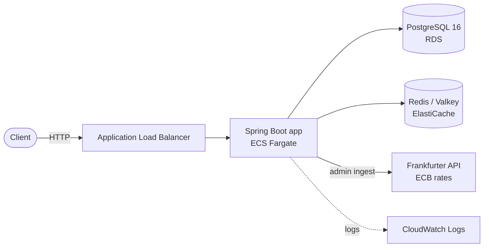

# Currency and Price Aggregation API

[](https://github.com/bhavingaikwad/currency-price-api/actions/workflows/ci.yml)

Spring Boot 4 / Java 21 REST API that serves the latest exchange rate per currency pair from two real datasets: ECB reference rates (about 222 thousand rows) and Binance 1-minute klines (about 5.2 million rows). Built to show backend performance work with measured results: removing an N+1 query, indexing, Redis caching, safe concurrent writes, authentication, rate limiting, CI, and a Terraform-defined AWS deployment.

## Measured results

k6 v2.3.0, 10 virtual users, 30 s per endpoint, Binance provider (5.2M rows), app in Docker on the same laptop as k6. Reproduce with `./scripts/loadtest.sh BINANCE 10 30s` (uses `docker-compose.loadtest.yml` to lift the rate limit).

| Endpoint | What it does | p50 | p95 | p99 | Throughput |
|---|---|---|---|---|---|
| `/latest-naive` | one query per pair (N+1) | 1.27 s | 2.75 s | 3.1 s | 6.5 req/s |
| `/latest` | single query + composite index | 2.07 ms | 4.8 ms | 8.04 ms | 3,945 req/s |
| `/latest-cached` | Redis cache-aside | 1.4 ms | 3.87 ms | 5.9 ms | 5,699 req/s |

The query rewrite and index account for almost all of the gain (p95 about 570x lower). The cache adds a smaller improvement (p95 19% lower) because the indexed query is already fast and every cache hit still checks a freshness watermark in PostgreSQL. These are single local runs, so they show relative differences, not production capacity.

## Architecture

The diagram shows the AWS deployment defined in `infra/`. Locally, `docker compose` runs the app, PostgreSQL and Redis.



**Request path for `/latest-cached`:** the JWT is verified, a per-user token bucket (Bucket4j) is checked, then the service reads a `data_loads` watermark from PostgreSQL. A Redis entry whose watermark matches is a hit; otherwise a single indexed query runs and the result is cached for 30 s. If Redis is down, requests fall back to PostgreSQL.

**Network:** only the load balancer is public. The app accepts traffic only from the load balancer, and the database and cache sit in private subnets and accept traffic only from the app.

## Run it locally

Needs Docker. Copy the example settings, fill in real values, start the stack:

```bash
cp .env.example .env   # set POSTGRES_PASSWORD, JWT_SECRET (long random string), READER_PASSWORD, ADMIN_PASSWORD
docker compose up -d --build
curl http://localhost:8080/actuator/health/readiness
```

The database starts empty: load the datasets first (see Datasets below).

## API

| Method | Path | Role | Notes |
|---|---|---|---|
| POST | `/api/v1/auth/token` | public | JSON `{username, password}` returns a 30-minute JWT; 5 attempts per minute per IP |
| GET | `/api/v1/rates/latest-naive?provider=` | USER | N+1 baseline, kept for comparison |
| GET | `/api/v1/rates/latest?provider=` | USER | single indexed query |
| GET | `/api/v1/rates/latest-cached?provider=` | USER | Redis cache-aside |
| POST | `/api/v1/admin/ingest?provider=ECB` | ADMIN | JSON `{base, quotes[]}`; fetches the latest ECB rates from Frankfurter; idempotent |
| GET | `/actuator/health/readiness` | public | database and app state, used by the load balancer |
| GET | `/actuator/metrics` | ADMIN | `rates.cache`, `rates.ingest`, `http.server.requests` |

`provider` is `ECB` or `BINANCE` (Binance has no live source, so admin ingest rejects it with 400). Two users exist, `reader` (USER) and `admin` (USER and ADMIN), with passwords from the environment. API calls are limited to 60 per minute per user; excess requests get `429` with `Retry-After`. Errors are RFC 9457 problem responses. Full spec: [docs/openapi.yaml](docs/openapi.yaml).

```bash
TOKEN=$(curl -s -X POST localhost:8080/api/v1/auth/token -H 'Content-Type: application/json' \
  -d '{"username":"reader","password":"<READER_PASSWORD>"}' | sed -E 's/.*"accessToken":"([^"]+)".*/\1/')
curl -H "Authorization: Bearer $TOKEN" "localhost:8080/api/v1/rates/latest-cached?provider=BINANCE"
```

## Tests and CI

59 tests (1 live-API test skipped by design), including integration tests against real PostgreSQL and Redis through Testcontainers. A JaCoCo gate fails the build under 95% line / 85% branch coverage; current coverage is about 97.5% line / 88.7% branch. Run `./mvnw verify` (Docker required). GitHub Actions runs the same command on every push and pull request and publishes the Docker image to GHCR from `main`.

## Observability

With `SPRING_PROFILES_ACTIVE=json` the app writes one JSON object per log line. Custom metrics: `rates.cache{result=hit|miss|stale|error}` and `rates.ingest{result=stored|duplicate}`, next to the built-in `http.server.requests` (which also shows 429s). A CloudWatch dashboard and two alarms (repeated 5xx, no healthy hosts) are defined in `infra/dashboard.tf` and `infra/alarms.tf`; they have not been deployed.

## Design decisions

Short decision records explain the main trade-offs:

- [One indexed query instead of N+1](docs/adr/0001-single-query-with-composite-index.md)
- [Cache-aside with a freshness watermark](docs/adr/0002-cache-aside-with-watermark.md)
- [AWS network without a NAT gateway](docs/adr/0003-aws-network-without-nat.md)

Writes are idempotent: a unique index on provider, pair and time plus `ON CONFLICT DO NOTHING` means concurrent or repeated loads cannot create duplicates (covered by a race test).

## AWS deployment

`infra/` is Terraform (AWS provider 6.x) for 45 resources in us-east-2: VPC with public and private subnets, security-group chain, RDS PostgreSQL 16, ElastiCache Valkey, ECR, ECS Fargate (ARM64), load balancer, SSM Parameter Store secrets, IAM role and CloudWatch logs. I deployed it, checked login, admin ingest and cached reads through the load balancer, then destroyed everything to avoid cost. See [docs/runbook.md](docs/runbook.md) to deploy or tear down.

## Known limitations

- AWS deployment is HTTP only (no domain or certificate) and the cache connection has no TLS in transit.
- Single-AZ database with backups off and a single app task; built for a demo, not for availability.
- Rate-limit buckets live in memory per instance, so they are not shared across tasks.
- The AWS demo held only the latest ECB snapshot (6 pairs against USD), not the Binance history.
- Terraform state is local (gitignored); a team setup would use a remote backend.
- Load-test numbers are single local runs, not capacity claims.

## Datasets (real data, not committed)

| Dataset | Source | Downloaded | Rows |
|---|---|---|---|
| ECB euro foreign exchange reference rates, full history | https://www.ecb.europa.eu/stats/eurofxref/eurofxref-hist.zip | 2026-11-06 | 221,847 (1999-01-04 to 2026-11-06, 41 currency columns, N/A values dropped) |
| Binance spot 1-minute klines, 20 USDT pairs, 2026-01 to 2026-06 | https://data.binance.vision/data/spot/monthly/klines/ | 2026-11-06 | 5,212,800 (120 monthly files, each SHA-256 verified) |

Raw files live under `data/` and are gitignored. Reproduce with `scripts/download_binance.sh`, `scripts/load_ecb.sh`, `scripts/load_binance.sh` (Postgres `COPY`, idempotent via the `data_loads` table). Data-quality checks: `scripts/dq_checks.sql`.
Binance data terms: check https://data.binance.vision before redistributing anything derived from it.
